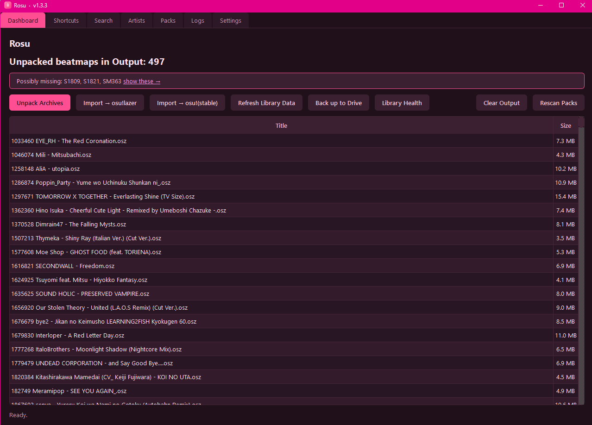
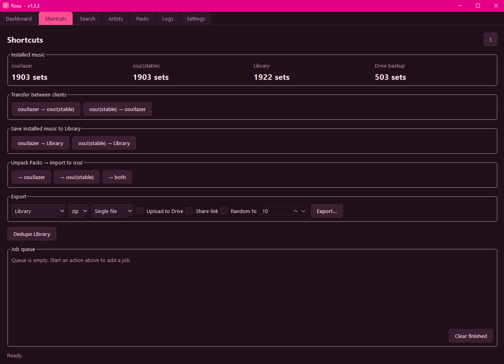
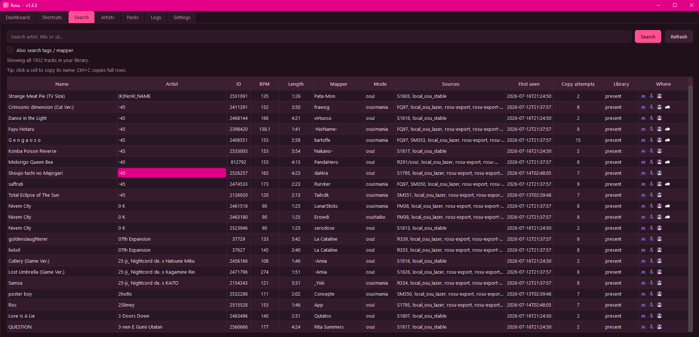
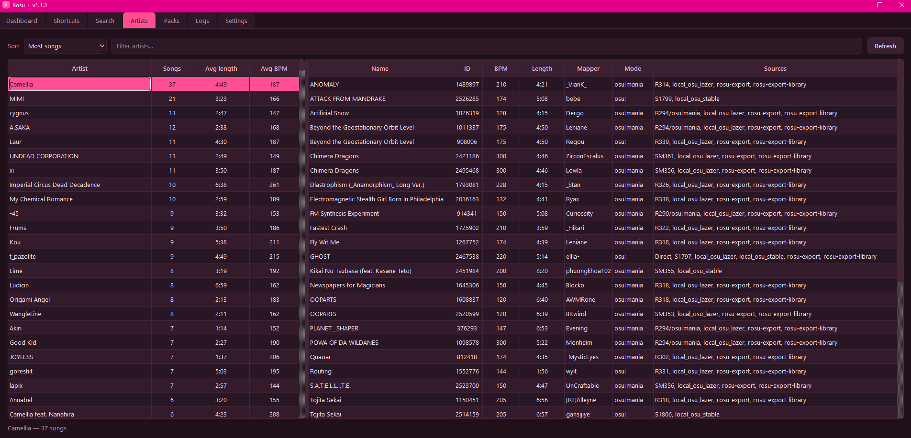
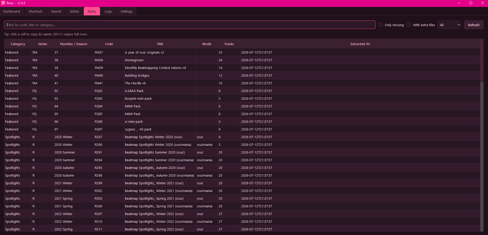
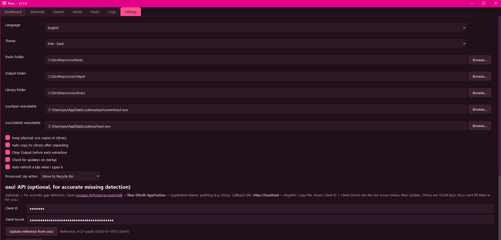
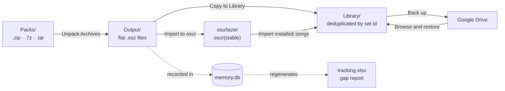

<a id="readme-top"></a>

<div align="center">


<br/>


<h3>A free desktop manager for osu! beatmap-pack archives</h3>

<p>
  <a href="https://github.com/Kerevizodunu2000/rosu/releases/latest"></a>
  <a href="LICENSE"></a>
  
  
  
</p>

<p>
  <a href="https://github.com/Kerevizodunu2000/rosu/releases/latest"><b>Download</b></a> ·
  <a href="https://rosu-web.vercel.app"><b>Website</b></a> ·
  <a href="CHANGELOG.md"><b>Changelog</b></a> ·
  <a href="https://rosu-web.vercel.app/report"><b>Report a problem</b></a>
</p>

<sub><i>rose + osu!</i></sub>

</div>

Rosu bulk-extracts `.zip`/`.7z`/`.tar` beatmap packs into a deduplicated `.osz` library, tracks everything (including **where each map lives**: osu!, your Library, the cloud) in a local SQLite database, flags real gaps in numbered pack series in an Excel report, and imports the results into **either osu! client** with one click. It can also pull beatmaps you've already installed straight into the library, **back the whole library up to your Google Drive**, and flag maps that no longer exist on osu!.

> [!NOTE]
> Background logic, code and logs are English by design. Only the user-facing UI is localized (English and Turkish, switchable in Settings).

## Quick start

1. **Download** the latest `rosu-<tag>-win64.exe` from [Releases](https://github.com/Kerevizodunu2000/rosu/releases) and run it. No installer, no dependencies.
2. **Drop** your beatmap-pack archives into the `Packs/` folder Rosu creates next to the exe, then click **Unpack Archives**.
3. **Import**: click **Copy to Library** to keep a permanent, deduplicated copy, then **Import → osu!lazer** or **Import → osu!(stable)**.

## Features

<table>
<tr>
<td width="33%" valign="top">📦 <b>Unpack any pack</b><br/><sub><code>.zip</code>, <code>.7z</code> and <code>.tar</code> into one flat folder of <code>.osz</code> files.</sub></td>
<td width="33%" valign="top">🗂️ <b>Deduplicated Library</b><br/><sub>One copy per beatmapset id, refreshed when a re-upload changes.</sub></td>
<td width="33%" valign="top">🎮 <b>Import to either client</b><br/><sub>osu!lazer and osu!(stable), through osu!'s own import pipeline.</sub></td>
</tr>
<tr>
<td valign="top">🔢 <b>Find missing packs</b><br/><sub>Real gaps in numbered pack series, flagged red in an Excel report.</sub></td>
<td valign="top">☁️ <b>Google Drive backup</b><br/><sub>Incremental, <code>drive.file</code> scope only, with browse and restore.</sub></td>
<td valign="top">🔍 <b>Search that understands maps</b><br/><sub><code>star&gt;5 mode=mania key=7</code>, filters, gallery, saved searches.</sub></td>
</tr>
<tr>
<td valign="top">🎹 <b>Mania skillsets</b><br/><sub>A local, offline skillset rating with a radar for every mania map.</sub></td>
<td valign="top">🧹 <b>Prune</b><br/><sub>Reclaim space from videos and images; every map still plays.</sub></td>
<td valign="top">🎵 <b>Same song, different sets</b><br/><sub>Audio fingerprints find the same song under different names.</sub></td>
</tr>
<tr>
<td valign="top">👻 <b>Lost-map detection</b><br/><sub>Flags sets you own that were deleted or taken down on osu!.</sub></td>
<td valign="top">🛡️ <b>Recoverable by design</b><br/><sub>Recycle Bin, previews, countdown confirms and disk-space checks.</sub></td>
<td valign="top">🔄 <b>Signed auto-update</b><br/><sub>Signature and SHA-256 checked, with rollback if a version fails to start.</sub></td>
</tr>
</table>

## Screenshots

<table>
<tr>
<td width="50%"><br/><sub><b>Dashboard</b>: unpack, import and back up from one place</sub></td>
<td width="50%"><br/><sub><b>Shortcuts</b>: one-click flows and the job queue</sub></td>
</tr>
<tr>
<td><br/><sub><b>Search</b>: every map, and where it lives</sub></td>
<td><br/><sub><b>Artists</b>: sortable aggregates per artist</sub></td>
</tr>
<tr>
<td><br/><sub><b>Packs</b>: every pack you own, with a missing-only filter</sub></td>
<td><br/><sub><b>Settings</b>: folders, themes and the optional osu! API</sub></td>
</tr>
</table>

<sub>Screenshots are from an earlier version in the Pink · Dark theme; today's tabs have more in them.</sub>

## How it works

Rosu's pipeline moves beatmaps through four stages:



1. **Packs**: drop `.zip` / `.7z` / `.tar(.gz/.bz2/.xz)` beatmap-pack archives into `Packs/`. Rosu scans and counts them.
2. **Output**: "Unpack Archives" extracts every pack into a flat `Output/` folder as `.osz` files, records each one to the local database, regenerates the Excel report, and recycles the processed archive.
3. **Library**: "Copy to Library" deduplicates `Output/`'s `.osz` files into a permanent `Library/` backup (by beatmapset id; repeat copies just increment a counter instead of creating `01`/`02` duplicates).
4. **osu!**: "Import to osu!" hands `Output/`'s `.osz` files to osu! in batches, which imports them through its own, trusted import pipeline.

Beatmaps you've already installed can skip straight to step 3 via **Settings → Import installed songs**, which reads them out of osu!(stable) or osu!lazer directly.

> [!TIP]
> Nothing Rosu removes is gone for good. Deletions go to the Recycle Bin after a preview and a countdown, and on a drive without a Recycle Bin Rosu keeps the file and tells you why. Unpack, Copy to Library, Export and Import to osu! check free space before they write anything.

## Installation

1. Go to the [Releases page](https://github.com/Kerevizodunu2000/rosu/releases).
2. Download the latest `rosu-<tag>-win64.exe` (for example `rosu-v1.10.0-win64.exe`) and, if you want to verify it, the matching `rosu-<tag>-win64.exe.sha256`.
3. Run it. No installer, no dependencies. On first launch Rosu creates its working folders next to the executable.

Every release ships a **`.sha256` checksum** so you can verify your download is untampered, and the update manifests that auto-update reads are **Ed25519-signed**.

> [!IMPORTANT]
> **First run: the "Windows protected your PC" / "unknown publisher" screen is expected.** Rosu is a new, independently built app that isn't code-signed with a (paid) certificate, so **Windows SmartScreen** warns the first time you run it. This is normal for small open-source apps. It means *"Windows doesn't recognize this yet,"* **not** *"this is malware."* To run it, click **More info** → **Run anyway** (Turkish: *Ek bilgi* → *Yine de çalıştır*). You'll only see it once on that PC. Rosu is [GPL-3.0 open source](LICENSE), and the warning goes away over time as more people run the app.

<details>
<summary><b>Step-by-step usage</b></summary>

1. Drop your beatmap-pack archives into the `Packs/` folder created next to the exe.
2. Click **Unpack Archives** to extract them into `Output/` and generate the tracking report.
3. Click **Copy to Library** to back up the extracted `.osz` files into your permanent `Library/`.
4. Click **Import → osu!lazer** or **Import → osu!(stable)** to hand them off to your osu! client.
5. Use **Search** to find tracks by artist/title/id, **Artists** to browse aggregates, and **Dashboard** for an at-a-glance summary (including a link straight to any possibly-missing packs).
6. Already have beatmaps installed? Open **Settings → Import installed songs** to pull them from osu!(stable) or osu!lazer without re-downloading anything.

</details>

<details>
<summary><b>Full feature reference</b></summary>

#### Archive pipeline
- Reads and counts every archive dropped into `Packs/`: **.zip, .7z, .tar (.gz/.bz2/.xz)**.
- Extracts everything into a flat `Output/` folder, flattening Spotlight-style `osu!/` / `osu!mania/` subfolders while still recording their original source.
- Archives that also contain non-music files (readmes, images…) are flagged, with a dedicated "with extra files" filter in the Packs tab.
- Detects and asks before re-processing a pack that's already been seen (fully vs. partially imported).
- Processed `.zip`/`.7z`/`.tar` files move to the Recycle Bin, never a permanent delete. An archive leaves `Packs/` only after every beatmap in it was extracted; one corrupt archive is skipped and left in `Packs/` instead of stopping the whole Unpack.

#### Library & import
- **Copy to Library** deduplicates `.osz` files by beatmapset id into a permanent `Library/` backup; re-uploads with a different size are refreshed instead of skipped.
- **Import to osu!** sends `Output/`'s `.osz` files to your osu! client in batches through osu!'s own safe import pipeline, with separate **osu!lazer** and **osu!(stable)** targets, progress, cancel support, and a reminder not to close osu! mid-import.
- **Import already-installed songs** (Settings): pulls beatmaps straight from an existing **osu!(stable)** `Songs/` folder or an **osu!lazer** install (via a bundled, self-contained .NET 8 helper that reads `client.realm` read-only, so no .NET install is required) and dedupes them into the Library.
- **Refresh Library Data** rescans `Library/`, backfills metadata, and timestamps files that have disappeared instead of silently dropping them.

#### Shortcuts (one-click flows)
- A dedicated **Shortcuts** tab with an installed-music summary (osu!lazer / osu!(stable) / Library / Drive set counts) and one-tap actions: **transfer** sets between osu!lazer ↔ osu!(stable) (skipping what the target already has), **save** an installed client straight into the Library, **unpack Packs and import** to either/both clients (with a skip-duplicates choice), **export** {Library | Drive-backed | a client | all-merged} to **zip/7z** (single or split into 1 GB / 500 MB volumes, with optional **★≥ / ★≤** star bounds on Library sets, optionally uploaded to Drive with a shareable link), and **dedupe** the Library (preview + confirm, Recycle Bin). Long operations are cancellable and show live progress in the job queue.
- **Remove from osu!**: take sets out of osu!(stable) (folders go to the Recycle Bin) with a preview of every set, its size and whether the Library already holds it. **Save and Remove** copies sets into the Library first and only removes the ones whose Library copy holds every file byte for byte. osu!lazer support (through lazer's own database, never by deleting its files, always saved first) is built and ships once verified on a real install.
- **Same song, different sets…** finds Library sets that use the same song (re-encodes, re-uploads, TV-size cuts) by fingerprinting the audio itself with Chromaprint, and recycles only the ones you pick (one set of every song always stays).
- **Move Library…** moves the whole Library to another folder or drive: a preview (files, size, free space, anything in the way), then every file is copied and SHA-256-checked before Rosu switches over; the old copies can go to the Recycle Bin afterwards. A cancel or a failed copy changes nothing.

#### Shortcuts job queue
- Long Shortcuts actions run as queued **jobs** with named sub-steps, live status, per-item cancel, and **DISK/DRIVE concurrency** (a disk export can run while a Drive upload proceeds). Double-click an archive row to reveal it in the file manager.

#### Cloud backup (Google Drive)
- **Back up your Library to Google Drive**: log in once (loopback OAuth + PKCE, the minimal `drive.file` scope so Rosu only ever sees the files it creates). New `.osz` are uploaded incrementally as fixed-size, append-only chunk archives; re-running uploads only what's new. A pre-backup dialog previews the new-set count and total size and lets you cap how many sets to send this run and pick the chunk size, including an **Individual (one file per set)** mode.
- **Drive storage at a glance**: Settings shows how much of your Drive storage is used of the total, how much Rosu's folder takes and how much is in Drive's trash. A backup checks for free space first and doesn't start when the upload won't fit; if Drive fills up mid-backup, it stops cleanly and keeps everything uploaded so far.
- **Browse and restore the backup** (Shortcuts → *Browse Drive backup…*): every set your Drive backup holds, from this PC and any other that backs up into it, with a filter. Select sets and Rosu downloads just the archives that hold them, checks every file against the SHA-256 recorded at backup time and imports them into the Library.
- **Location tracking**: Rosu records which Drive chunk holds each backed-up set, and the Search table shows where every map lives: 🎮 osu!lazer · 🕹️ osu!(stable) · 💾 Library · ☁️ Drive.
- Optionally, a processed pack archive can be **uploaded to Drive and removed locally** right after unpacking, to reclaim disk space.
- The OAuth refresh token is stored in the **OS keyring** (Windows Credential Manager), never in `config.json`.

#### Know what's gone
- **Lost-map detection** (optional; needs osu! API credentials): flags owned beatmapsets that no longer exist on osu! (deleted or taken down), so you know what's already unrecoverable. Most pack archivers don't surface this at all.

#### Search, metadata & reporting
- Relevance-ranked **Music Search** (tokenized AND on artist/title/name; optional tag/mapper search) with per-difficulty **Star** and **Keys** columns, a **Skill** column for mania (overall + dominant skillset, e.g. `5.42 CJ`), and location badges (🎮 lazer · 🕹️ stable · 💾 Library · ☁️ Drive).
- **Browse your way**: hide or show any Search column (right-click a header; remembered), **★ Saved** searches, ◀ ▶ through the last 16 searches (<kbd>Alt</kbd>+<kbd>←</kbd>/<kbd>→</kbd>), a **▦ Gallery** of cover art, and **Export…** of the listed sets to CSV or JSON. Right-click sets → *Copy to Output* to send exactly those to osu!.
- **Query-syntax filters**: combine free text with `star>5`, `mode=mania`, `key=7`, `bpm>=180`, `length=4:03`, `status=ranked`, `pruned=yes`, `artist=`/`mapper=`/`name=`, and CS/AR/OD/HP bounds; diff-level filters must match on the *same* difficulty. Results are never silently truncated: if a query hits the display ceiling the count line says so.
- **Visual Filters panel**: a collapsible Search sidebar with a dual-handle star slider, ruleset toggles (disabled when you own no maps of that mode), mania key picker, and BPM/length/AR/OD fields; writes the query syntax for you.
- **Map Details** (double-click a result): every difficulty's mode, keys, star, CS·AR·OD·HP, and (for mania) a **skillset radar**; plus osu!-API metadata when enriched.
- **Star histogram** (Search → Distribution): your whole Library's distribution, counted **per difficulty** (the same unit the `star>=` filter uses). Choose data-fitted ranges or plain whole-star buckets (0–1, 1–2, …); click/drag a range, double-click to search it, or **Export this range** straight into Shortcuts.
- **Rosu Skillset Rating (mania)**: a local, offline heuristic across Etterna's seven skillsets + overall (not an Etterna port; swappable). Rated at unpack/refresh; whole-Library rescan from Settings. Packs: double-click a present pack for its average mania radar.
- **Local star ratings** via **rosu-pp-py** (pinned, import-guarded) for every difficulty; optional **osu!-API metadata enrichment** (ranked status, dates, play/favourite counts, genre, language) from Settings.
- Browsable **Artists** tab with sortable aggregates (avg. star, length, BPM) and an instant filter box.
- Auto-generated **Excel report** (`data/tracking.xlsx`) with per-category sheets, an Artists sheet, and a Summary, with confirmed-red rows only.
- One-click cell copy, <kbd>Ctrl</kbd>+<kbd>C</kbd> for a full TSV of the selection, and right-click "Copy names".

#### Space saving (Prune) & collections
- **Prune** (Shortcuts) recycles the heavy extras from beatmap sets to reclaim disk space, choosing everything at the point of use: **where** (your Rosu Library or osu!(stable)'s `Songs/` folders), **what** (video only · images only · video + images · smart clean-up, which keeps whatever a beatmap references plus small images/hitsounds), **how many and in what order** (biggest-saving-first, smallest-first or by name, with a limit). A read-only scan previews every set (its size and exactly how much it would free) before a countdown confirmation. The `.osu` beatmaps are never removed, so every map still plays, and what is removed goes to the Recycle Bin. Pruned sets are marked in Search (`pruned=yes` lists them) and can be restored from Map Details.
  - **Restore pruned maps** asks where the files should come back *from*: the **Recycle Bin** (free and byte-identical: prune leaves each original there under its own name, `Artist - Title.osz.orig`) or an **osu! mirror** (named explicitly as third-party). It also explains why the official osu! servers aren't an option. Which sets were pruned, **where**, when, and with which mode is recorded and shown; a set stripped in your Library isn't claimed to be stripped in osu!lazer too.
  - *osu!lazer cannot be pruned by removing files, and this is not a setting:* lazer stores each file by content hash and **shares one copy between every set containing that asset**, so deleting one set's video would break others and leave lazer's database pointing at a missing file. Pruning it therefore means going the long way round, and **Prune osu!lazer** walks you through exactly that: save everything into the Library, delete the beatmaps in lazer's own Maintenance screen, let Rosu confirm the file store really emptied, prune the Library, then send it all back. Every step is explained and confirmed, and the delete step stays locked until every set is verified present in your Library.
  - **Auto-Prune** (Settings) prunes new maps as they're added to the Library; **Export Prune** prunes only the copy sent to osu! or exported to a folder/archive, leaving the Library file itself untouched.
- **Sync Collections** (Settings) reads osu!(stable)'s `collection.db` and tags matching Library maps with their collection name.
- **Repair** (Search, right-click a missing or pruned map) re-downloads it from a third-party osu! mirror (not the official osu! servers, disclosed before the download starts) and clears its pruned flag on success.

#### Library health & settings
- **Library Health** (Settings): read-only disk-usage total + biggest sets, a DB↔disk scrub (orphans / dead links / memory-only), and a cancellable off-thread **SHA-256 verify** against backup-time hashes.
- **Watch a folder** (Settings, opt-in): new `.osz` downloads that land in a chosen folder are added to the Library (ones that arrive while Rosu is closed, at the next start); what was already there is left alone and your files are never moved or deleted.
- **Logs**: any day's log as a filterable table (errors only, word filter), growing live.
- Per-client **enable/disable** toggles (lazer on, stable off by default). A disabled client vanishes app-wide (Settings path row, Dashboard import, Shortcuts).
- **Save ⇄ Auto-Save** for Settings; **Report a problem** posts to the hosted form (with e-mail / web-form fallback) and shows a private link to follow your report's status (received → in review → fixed in vX).
- Optional startup **update check** (Rosu's site first, GitHub as the fallback) with a banner linking the new `.exe` directly (on by default, fails silently offline).
- **Auto-update** for the Windows exe (on by default; Settings → *Install updates automatically*): it downloads the new release in the background, checks its signature and SHA-256, installs it when you click **Restart now** (or on the next start) and rolls back a version that fails to start. After an update, Rosu says once which version was installed, with the release notes when available. **Restart now** during a running task waits for the task (and any open dialog) to finish, then restarts; **Cancel restart** stops it.
- Opt-in **anonymous crash reports** (off by default): the error type, a scrubbed message and the code locations involved. No files, no library data, no usernames.

#### Safety & robustness
- Archive extraction is hardened against path traversal (drive-relative/ADS entry names) and zip-bomb/disk-exhaustion (size caps before unpacking).
- **Disk-space checks**: Unpack, Copy to Library, Export and Import to osu! check the free space first and refuse before writing anything, with a message naming the drive. A disk that fills up during the run stops it cleanly with "disk full": what was already written stays, and the archive stays in `Packs/`.
- **Recycle Bin guards**: on a drive with no Recycle Bin (removable or network, or one whose Recycle Bin is turned off), or for a file or set folder too large for it, Rosu keeps the file and says why instead of deleting it for good. This covers Unpack, dedupe, Prune, Remove from osu! and the Library deletes.
- Guarded, countdown-confirmed deletions before removing physical Library copies.
- Crash-safe report writes (a locked `tracking.xlsx` no longer aborts an import) and clean shutdown of background workers.
- **Folder self-heal**: if the app's own folder is moved or renamed, it detects the mismatch on launch and offers (with confirmation) to re-point to wherever `Library/`/`data/`/`logs/` actually live.

#### Customization
- 12 built-in themes (see *Themes* below); toggles in Settings apply immediately in Auto-Save mode.
- Mouse-wheel guard on dropdowns so scrolling never silently changes a value.
- English/Turkish UI switch.

</details>

<details>
<summary><b>Gap detection</b></summary>

Rosu highlights *missing* packs in the Excel report, but only when it can be confident:

- **Standard series (S / SM / ST / SC)**: osu! numbers these gaplessly, so a missing number in the sequence is a genuine gap → shown **red** (e.g. `S1821`, `SM363`). No network access needed.
- **Featured / Spotlights / Theme / Artist / Loved / Tournament / unofficial packs**: these aren't gaplessly numbered, so offline detection can't tell a real gap from an intentional one. They're **listed, never marked red**, to avoid false positives.
- **Optional osu! API reference**: enter an osu! API v2 `client_id` + `client secret` in Settings and run "Update Reference." Rosu fetches the authoritative, published pack list and cross-checks every category (including Spotlights) against it, so gap detection becomes **100% accurate** for all pack types, not just Standard.

Extra numbered pack series (ST/SC/T/L/P/A and beyond) are already auto-supported by the gap-detection logic as they appear.

</details>

<details>
<summary><b>Themes</b></summary>

12 themes, switchable instantly from the Settings tab:

Dark *(default)*, White, Pink, Pink · Light, Pink · Dark, Pink · Darker, Nord, Dracula, Catppuccin Mocha, Catppuccin Latte, Solarized Dark, Solarized Light.

The light themes meet the WCAG contrast targets for muted text, primary buttons and progress bars.

</details>

<details>
<summary><b>Folder layout</b></summary>

```
Packs/        Incoming .zip/.7z/.tar pack archives (input)
Output/       Extracted, flattened .osz files (current batch), staged for import to osu!
Library/      Permanent, deduplicated .osz backup
Processed/    Archives moved aside after unpacking (when that disposal mode is chosen)
Quarantine/   Rejected hostile archives (zip-bomb / path-traversal), never auto-deleted
data/         memory.db (SQLite, single source of truth) + tracking.xlsx + Drive cache
logs/         app-YYYY-MM-DD.log + log_formats.md
config.json   Application settings (osu! API key kept here; Drive token in the OS keyring)
```

</details>

<details>
<summary><b>Build from source</b></summary>

#### Run from source

```bash
pip install -r requirements.txt
python tools/fetch_fpcalc.py   # optional: the audio-fingerprint tool for "Same song, different sets"
python run.py
```

#### Build the exe

Builds a single self-contained `rosu.exe`. End users don't need Python or any dependencies installed. CI builds with Python 3.14.

```bash
pip install -r requirements-dev.txt
python tools/fetch_fpcalc.py windows   # bundled Chromaprint fpcalc, checked against a pinned SHA-256
pyinstaller rosu.spec
# output: dist/rosu.exe
```

For a tagged release, CI publishes it as `rosu-<tag>-win64.exe` with a matching `rosu-<tag>-win64.exe.sha256`, plus the Ed25519-signed update manifest (`rosu-update.json` and `rosu-update.json.sig`) that auto-update reads.

#### Testing

```bash
python -m pytest tests/ -q
```

`rosu.exe --selftest` smoke-tests a packaged build, including the 7z codecs inside the exe; CI runs it on every build.

</details>

<details>
<summary><b>FAQ</b></summary>

**Is Rosu free?**
Yes. It is GPL-3.0-or-later open source and takes no money: no paid tier, no ads, no donations.

**Does Rosu touch osu!lazer's files?**
No. Rosu reads osu!lazer's `client.realm` read-only to import installed songs, and imports go through osu!'s own import pipeline. lazer shares one stored file between sets, so Rosu never deletes lazer's files; Prune osu!lazer walks you through lazer's own Maintenance screen instead.

**What does Rosu see in my Google Drive?**
Only the files it creates. It asks for the `drive.file` scope, and the login token lives in Windows Credential Manager, not in `config.json`.

**Does it need the internet?**
No. Unpacking, the Library, Search, ratings and Standard-series gap detection all work offline. The osu! API (lost maps, enrichment, the exact pack reference), Drive backup, mirror repair and the update check are optional.

**Why does Windows warn me the first time?**
The exe isn't code-signed with a paid certificate, so SmartScreen doesn't know it yet. See *Installation* above, and check the `.sha256` if you want to verify your download.

**macOS or Linux?**
Not yet.

</details>

## Community & support

- **Website**: **<https://rosu-web.vercel.app>**
- **Report a bug or request a feature**: from inside the app (**Settings → Report a problem**), or fill in the form at **<https://rosu-web.vercel.app/report>** (title + description + an optional screenshot). Prefer e-mail? **rosu.app@gmail.com**. GitHub users can also [open an issue](https://github.com/Kerevizodunu2000/rosu/issues).
- **Security issues**: please report privately; see [SECURITY.md](SECURITY.md).
- **Follow Rosu:** [Instagram](https://www.instagram.com/rosu.app/) · [YouTube](https://www.youtube.com/@RosuApp) · [Reddit](https://www.reddit.com/user/RosuApp/) · [X (Twitter)](https://x.com/RosuApp)

## License

Rosu is free software, licensed under the **[GNU General Public License v3.0 or later](LICENSE)**.

Copyright © 2026 Halil Şafak Şimşek.

**Contact:** rosu.app@gmail.com

Rosu is distributed in the hope that it will be useful, but **WITHOUT ANY WARRANTY**; see the [GNU GPL v3](LICENSE) for details. Bundled third-party components keep their own licenses; see [THIRD-PARTY-LICENSES.md](THIRD-PARTY-LICENSES.md). The same notices are available in-app via **Settings → About / Licenses**.

> [!NOTE]
> Rosu is an unofficial, fan-made tool, not affiliated with or endorsed by ppy Pty Ltd or osu!. "osu!" is used descriptively; the "Rosu" name and glyphs are the author's own.

<div align="center">
<sub><a href="https://rosu-web.vercel.app">rosu-web.vercel.app</a> · <a href="#readme-top">Back to top ↑</a></sub>
</div>
